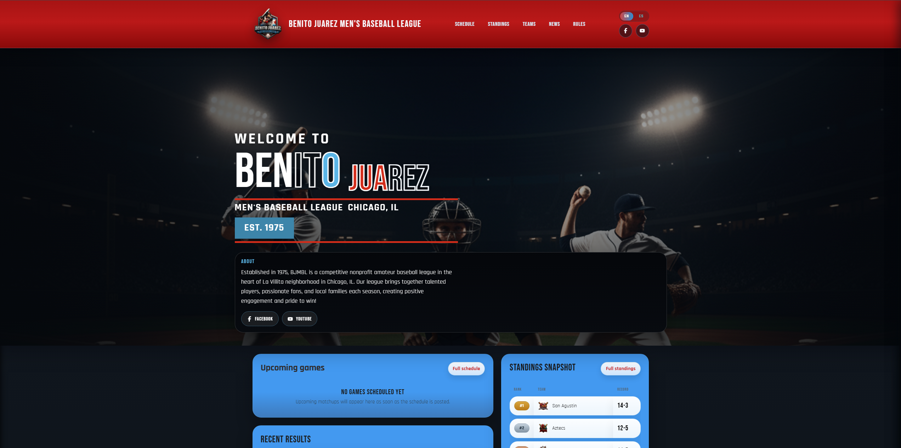

# ⚾ Benito Juarez Men's League Platform

> Live at [benitojuarezbaseball.com](https://benitojuarezbaseball.com)



## Overview

Benito Juarez Men's League is a 10-team baseball league with roughly 15–20 players per team, along with team managers and league administrators. Before the platform, league information and operations were spread across group chats and social media posts, making it harder to keep schedules, rosters, and updates in one place. I built a central website where players can follow the league and managers and admins can handle league operations online.

## Features

- Public schedules, standings, team rosters, and league announcements.
- Mobile-friendly pages for players and fans.
- Manager accounts and role-based access for team and league operations.
- Admin tools for maintaining league information and managing updates.
- Lineup and roster workflows, including CSV imports.
- Photo uploads and team imagery.

## How I Built It

The frontend uses React and TypeScript, and the API is built with FastAPI. PostgreSQL, hosted on Neon, stores the league data. The frontend and backend are deployed as separate Vercel projects, with the frontend calling the API for data and authenticated operations.

```mermaid
flowchart LR
    U[Players, managers, admins] --> W[React + TypeScript frontend]
    W --> A[FastAPI backend]
    A --> D[Neon PostgreSQL]
